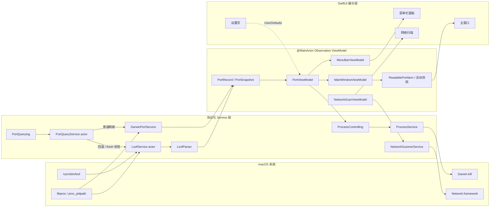
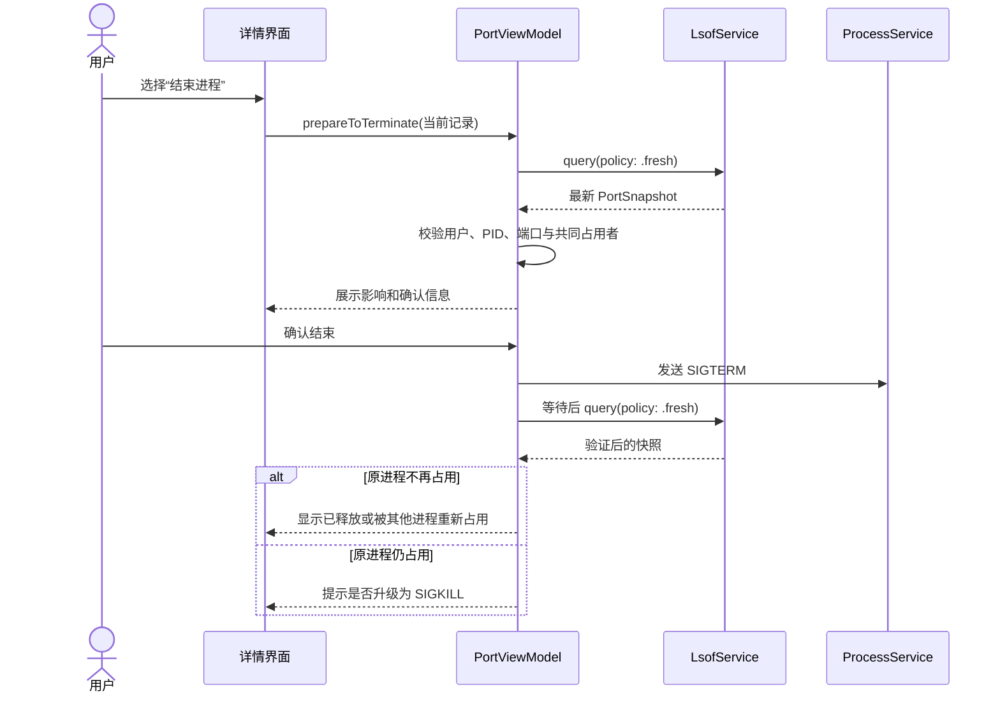

<div align="center">
  
  <h1>Port Viewer</h1>
  <p>一眼看懂端口被谁占用，以及应用正在进行什么网络活动。</p>

  <p>
    <a href="https://github.com/super-213/port-viewer/actions/workflows/xcode-build-analyze.yml"></a>
    
    
  </p>
</div>

Port Viewer 是一款使用 SwiftUI 构建的 macOS 原生端口查看工具。它把 macOS 原生 API 返回的进程、端口和连接信息转换成更容易理解的中文结论，让不熟悉命令行的用户也能快速找到端口占用者，并在明确了解影响后结束对应进程。

所有数据处理都在本机完成，不需要账号，也不会上传进程、连接或扫描结果；主动扫描只会连接用户指定的目标。

## 功能亮点

- **易懂的网络状态**：将 `LISTEN`、`ESTABLISHED` 等技术状态转换为“等待连接”“连接已建立”等中文说明。
- **可视化连接流程**：紧凑表格中直接展示访问来源、端口、进程和连接目标的迷你拓扑；顶部标签切换活动类型，右侧详情展示完整连接关系与技术信息。
- **快速搜索与筛选**：按进程名、PID 或端口搜索，支持范围、访问来源、进程归属、协议、IP 版本和 TCP 状态筛选。
- **TCP 与 UDP 一并查看**：展示监听端口、已建立连接、连接变化和其他网络活动，同时保留完整技术字段。
- **主动 TCP 端口扫描**：测试另一台设备的指定端口，或扫描 IPv4 CIDR 网段；支持常用端口、1–1024、单主机全部端口和自定义端口段。
- **菜单栏快捷入口**：无需打开主窗口即可查看概况、搜索记录、刷新数据或定位到详情。
- **自动刷新**：前台和后台可使用不同刷新间隔，也可暂停或手动刷新。
- **谨慎释放端口**：操作前重新确认进程仍在占用目标端口；优先发送 `SIGTERM`，必要时才提示使用 `SIGKILL`，操作后再次查询验证结果。
- **系统级使用体验**：支持浅色/深色外观、键盘快捷键和 VoiceOver 友好的文字说明。

## 系统要求

- macOS 15.0 或更高版本
- Xcode 16 或更高版本（持续集成使用 Xcode 16.4）
- 系统自带的 `/usr/sbin/lsof`

项目不依赖第三方 Swift Package。

## 快速开始

克隆仓库并打开 Xcode 项目：

```bash
git clone https://github.com/super-213/port-viewer.git
cd port-viewer
open PortViewer.xcodeproj
```

在 Xcode 中选择 `PortViewer` scheme 和 `My Mac`，然后按 `⌘R` 构建并运行。

也可以从命令行完成无签名构建：

```bash
xcodebuild \
  -project PortViewer.xcodeproj \
  -scheme PortViewer \
  -configuration Debug \
  -destination 'generic/platform=macOS' \
  CODE_SIGNING_ALLOWED=NO \
  build
```

## 使用方法

1. 启动应用后，Port Viewer 会自动读取当前 TCP/UDP 端口和连接。
2. 在搜索框输入进程名、PID 或端口号；输入 `:3000` 可只精确匹配端口 `3000`。
3. 从顶部标签选择“等待连接”“连接活动”或“其他活动”，也可以组合更多筛选条件。
4. 在列表中直接查看迷你连接流程；选择记录后，右侧展示完整连接图、状态、访问范围和技术详情。
5. 如需释放端口，选择“结束进程”并确认影响。应用会在发送信号前后分别校验一次实时状态。

### 扫描另一台设备或局域网

1. 在主窗口顶部选择“网络扫描”。
2. 选择“单台主机”并输入主机名/IP，或选择“局域网网段”并输入 IPv4 CIDR，例如 `192.168.1.0/24`。
3. 选择端口预设；主动测试单个端口时选择“自定义”并输入例如 `443`，也可输入 `22,80,443,8000-8100`。
4. 开始扫描后可查看进度并随时取消；扫描完成后只列出成功建立 TCP 连接的开放端口。

为避免一次产生数千万次连接探测，单次最多扫描 1,024 台主机和 300,000 个“主机 × 端口”组合。单台主机可扫描全部 65,535 个 TCP 端口；较大网段应选择常用端口或较小的自定义范围。

常用快捷键：

| 快捷键 | 操作 |
|---|---|
| `⌘F` | 聚焦进程/端口搜索 |
| `⌘R` | 立即刷新 |
| `Esc` | 清空当前搜索 |

## 项目归属与服务管理

列表和菜单栏会在可识别时展示“项目名 · 框架”，并支持按项目名、框架或项目目录搜索。详情保留原始进程名，并补充工作目录、项目目录、启动参数和启动时间。项目识别向上查找最近的 `package.json`、`Cargo.toml`、`pyproject.toml`、`go.mod`、`Package.swift` 或 `.git`；框架根据启动参数或程序名识别，不根据端口号猜测。元数据只读取当前用户可见的信息，未知时保留原始名称。常见密钥参数会隐藏，环境变量不展示或保存。

- **Docker**：安装 Docker CLI 且本地 Unix socket 可用时，读取运行容器的发布端口，并与已知 Docker 转发进程的地址、端口、协议关联。确认后按完整容器 ID 执行 `docker stop --timeout 10`，停止整个容器；10 秒后 Docker 可能强制停止。操作不会结束共享 Docker 后台进程。仅使用明确的本地 socket，不跟随远程 Docker context；自定义转发器或无法唯一确认的映射不提供停止操作。
- **Homebrew**：支持 `/opt/homebrew` 和 `/usr/local` 安装。结合当前用户的 `launchctl list`、进程祖先链和公式安装路径识别运行服务。确认后执行 `brew services stop <formula> --max-wait=10`，停止服务并取消登录时自动启动。系统级或归属无法确认的服务不会被操作。
- **身份校验**：普通进程在确认后重新获取完整端口快照，并在发送 `SIGTERM` 或 `SIGKILL` 前核对 PID、用户及微秒精度的启动时间。身份无法读取或发生变化时拒绝发送信号。Docker 额外核对容器 ID 和 `StartedAt`，Homebrew 核对 launchd 服务进程的启动身份；停止后验证服务和端口状态。
- **刷新开销**：进程元数据按启动身份缓存 30 秒，服务清单缓存 15 秒，危险操作绕过缓存。Docker/Homebrew 不可用时保留本机端口记录并清除无法验证的服务关联。

Darwin 的身份读取与 `kill` 不是原子操作；上述校验缩小竞争窗口，但不能承诺完全消除系统调用之间的竞态。项目文件只用于读取元数据，不会执行其中的脚本。

## Cloudflare Tunnel 域名联动

开启设置中的“检测本机 Cloudflare Tunnel”后，应用会从已确认的本机 `cloudflared` 监听端点读取运行映射，在对应端口旁显示域名及隧道连接状态。支持本机 HTTP(S) 回环目标、Quick Tunnel 和运行接口可读的命名隧道，不需要 Cloudflare API Token，也不依赖磁盘配置文件。

- 主窗口和菜单栏共享结果，支持按域名搜索；“更多筛选”可选择“有 Cloudflare 映射”。详情按目标端口列出域名、路径规则及观测时间，并提供复制域名和具体 HTTP 应用域名的打开入口。
- 如果监听进程归属不可见，可在设置的“手动诊断端点”填写例如 `http://127.0.0.1:20241`，点击“应用诊断端点”。手动来源明确标为“进程归属未确认”；仅接受带端口的回环 HTTP 地址。
- “隧道已连接”只说明连接器与 Cloudflare 边缘建立了连接；公网 DNS、Access、源站及应用可用性未检测。读取失败显示未知并保留上次映射，超期数据有独立提示。
- 关闭检测会取消请求并清除当前结果；暂停自动刷新也暂停隧道探测。域名数据仅存内存，不读取运行 token、凭据或环境变量，不修改或停止隧道。

当前实现仅关联同机 IPv4/IPv6 回环目标，无法自动归因另一台服务器、容器/VM 网络或非回环源站；不支持旧版本接口缺失时的 YAML/API 降级。已对 `cloudflared 2026.10.7` 的真实 Quick Tunnel 验证接口结构；其他版本及命名隧道的支持证据见[实施计划](docs/cloudflare-tunnel-integration-plan.md)。

## 安全与隐私

- 普通刷新通过 macOS `libproc` 采集 TCP/UDP，涵盖文件描述符和 Mach fileport；异常时回退到系统 `/usr/sbin/lsof`。结束进程前始终使用新的 `lsof` 快照校验，所有查询均在本地执行。
- 主动扫描直接使用系统 Network framework 建立 TCP 连接，不执行用户输入的 Shell 命令，也不上传扫描结果。
- 请只扫描自己拥有或明确获准测试的设备和网络；应用不会绕过防火墙或隐藏扫描来源。
- “未探测到开放”不等同于确定关闭：目标也可能被防火墙过滤、无法路由或没有在所选超时时间内响应。
- 当前版本不申请管理员权限，只允许结束当前登录用户拥有的进程。
- 对 `launchd`、`kernel_task` 等关键系统进程禁用强制结束。
- “同一网络可能访问”仅根据监听地址推断，不代表端口已经暴露到公网；实际访问仍受防火墙和网络环境影响。
- 受 macOS 权限限制，部分其他用户或系统进程的信息可能不可见。

## 技术架构

项目采用 **MVVM + Service + Observation + Swift Concurrency**。`PortViewerApp` 是组合根，显式创建协议化 Service、全局 `PortViewModel` 和三个页面级 ViewModel。主窗口与菜单栏共享同一份本机查询快照，网络扫描拥有独立的可取消任务与结果状态；View 不直接执行系统命令或网络连接。



> 图中的 libproc API 用于端口采集、进程身份与路径补充；`Darwin.kill` 仅在用户确认结束进程后调用。

### 分层职责

| 层级 | 主要文件 | 职责 |
|---|---|---|
| 应用入口 | [`PortViewerApp.swift`](PortViewer/PortViewerApp.swift) | 注册窗口、菜单栏、设置与命令，显式组装 Service 和 ViewModel，并管理应用级启动/停止 |
| 展示层 | [`MainWindowView.swift`](PortViewer/Views/MainWindowView.swift)、[`MenuBarPanel.swift`](PortViewer/Views/MenuBarPanel.swift)、[`SettingsView.swift`](PortViewer/Views/SettingsView.swift) | 布局、绑定、焦点和局部展开状态；用户事件转发给 ViewModel |
| 全局 ViewModel | [`PortViewModel.swift`](PortViewer/ViewModels/PortViewModel.swift) | 共享快照、刷新循环、查询状态、连接变化以及结束进程安全用例 |
| 页面 ViewModel | [`MainWindowViewModel.swift`](PortViewer/ViewModels/MainWindowViewModel.swift)、[`MenuBarViewModel.swift`](PortViewer/ViewModels/MenuBarViewModel.swift) | 主窗口筛选/排序/选择恢复和菜单栏搜索/展示上限；缓存重复分组结果 |
| 展示模型 | [`NetworkPresentation.swift`](PortViewer/Models/NetworkPresentation.swift) | 将原始网络记录归组，生成中文状态、访问范围、连接结论和活动变化 |
| 数据模型 | [`PortRecord.swift`](PortViewer/Models/PortRecord.swift) | 定义原始端口记录、查询快照、端点格式和搜索匹配规则 |
| 查询服务 | [`PortQueryService.swift`](PortViewer/Services/PortQueryService.swift)、[`DarwinPortService.swift`](PortViewer/Services/DarwinPortService.swift)、[`DarwinSocketReader.swift`](PortViewer/Services/DarwinSocketReader.swift)、[`LsofClient.swift`](PortViewer/Services/LsofClient.swift) | 跨后端 single-flight、原生采集、lsof 回退与 fresh 校验、取消清理及共享元数据补全 |
| 扫描服务 | [`NetworkScanner.swift`](PortViewer/Services/NetworkScanner.swift) | 使用 Network framework 并发执行 TCP connect 探测，限制并发并支持超时与取消 |
| 扫描页面 | [`NetworkScan.swift`](PortViewer/Models/NetworkScan.swift)、[`NetworkScanViewModel.swift`](PortViewer/ViewModels/NetworkScanViewModel.swift)、[`NetworkScanView.swift`](PortViewer/Views/NetworkScanView.swift) | 解析主机、CIDR 与端口范围，校验扫描规模，并展示进度和开放端口报告 |
| 进程服务 | [`ProcessControlling.swift`](PortViewer/Services/ProcessControlling.swift)、[`ProcessController.swift`](PortViewer/Services/ProcessController.swift) | 检查 PID、发送信号、稳定映射系统错误并保护关键系统进程 |

### 查询与刷新数据流

1. `PortViewModel.start()` 触发首次查询，并持有可取消的自动刷新循环。
2. `PortQueryService` 以 actor 隔离跨后端 single-flight 状态；普通刷新在 utility 任务中调用 `DarwinPortService`，通过 `proc_listpids`、FD/fileport 列表与 socket info 采集端口。
3. 原生明确失败或不完整时回退 `LsofService`；危险操作的 `.fresh` 查询始终重新执行 `/usr/sbin/lsof -nP -iTCP -iUDP -F0pcuLRftnPT`，由 `LsofParser` 解析。两条路径共享进程元数据缓存和服务识别，补充项目、可执行路径及启动身份。
4. 查询结果以完整 `PortSnapshot` 返回，并在 `@MainActor @Observable` 的 `PortViewModel` 中一次性应用。
5. `MainWindowViewModel` 只在原始记录变化时重新生成 `ReadablePortItem`，再在内存快照上搜索、筛选和排序。
6. Observation 只让读取了相应状态的 SwiftUI 视图失效；Task、Service 引用与缓存通过 `@ObservationIgnored` 排除。

刷新机制的关键约束：

- 使用现有自适应刷新间隔：前台 3–10 秒、菜单栏 5–15 秒，默认后台 30–60 秒，可在设置页调整基础间隔。
- 原生采集具有 5 秒协作式时间预算、列表扩容上限和取消检查；每次 lsof 执行的超时为 5 秒。发生回退时会先后执行两个后端，总耗时可能更长；项目与服务补全另计。Process 与 Pipe 继续使用可取消异步会话。
- 普通查询复用正在执行的 single-flight；危险操作的 `.fresh` 等待当前刷新结束后启动独立 lsof 查询。lsof 不可用或结果不完整时，禁止危险操作，不接受原生快照替代。
- 自动刷新不会堆积；查询期间收到的手动刷新会合并为下一次查询。
- 单个等待者取消不会取消共享查询；应用退出会由全局 ViewModel 明确取消当前查询。取消不会触发回退。
- “技术详情”显示实际采集来源和包含信息补全的总耗时。快照 diagnostics 分别记录采集、补全耗时以及权限限制、进程消失和回退原因。
- 完整查询失败时保留上一份快照和最后成功时间；部分结果会明确标记，不会被当作完整结果用于危险操作。
- 每次快照会与上次结果比较，短暂展示监听端口中新出现、结束或变化的连接活动。
- 完整快照会生成活动构成、协议/IP、监听访问范围和应用排名，并保留最近 30 分钟的会话内趋势；部分快照不进入趋势基线，退出应用后历史自动清空。

### 核心数据模型

| 类型 | 作用 |
|---|---|
| `PortRecord` | 一条未经简化的 TCP/UDP 记录，包含进程、PID、用户、文件描述符、协议、地址、端口和状态 |
| `PortSnapshot` | 一次查询的原子结果，附带采集时间、耗时和“结果是否不完整”标记 |
| `QueryPresentationState` | 区分加载、正常、空数据、暂停、部分结果、失败和 `lsof` 不可用等界面状态 |
| `ReadablePortItem` | 面向用户的归组记录，保存全部原始记录，并提供中文结论、状态与访问范围 |
| `PortActivitySnapshot` | 记录监听端口对应的连接标识和远端端点，用于计算两次刷新之间的变化 |
| `TerminationPrompt` | 保存普通/强制结束阶段、目标记录、其他连接、共同占用者和关键进程标记 |

### 结束进程时序

结束端口占用者不是直接执行 `kill`。应用会重新查询实时状态、校验进程归属并让用户确认，之后再验证操作结果。



关键系统进程禁止强制结束；其他用户拥有的进程不会被操作；如果操作前查询不完整，则不会发送任何信号。

## 项目结构

```text
port-viewer/
├── .github/workflows/
│   └── xcode-build-analyze.yml     # GitHub Actions 构建与静态分析
├── PortViewer/
│   ├── Models/
│   │   ├── PortRecord.swift        # 原始端口模型与搜索
│   │   └── NetworkPresentation.swift # 易懂化模型与连接变化
│   ├── Services/
│   │   ├── PortQuerying.swift      # 查询协议与复用/强制新查询策略
│   │   ├── LsofClient.swift        # LsofService、single-flight 与异步进程桥接
│   │   ├── LsofParser.swift        # lsof 机器输出解析
│   │   ├── NetworkScanner.swift    # 可取消的并发 TCP connect 扫描
│   │   ├── ProcessControlling.swift # 进程控制协议
│   │   └── ProcessController.swift # ProcessService 与关键进程保护
│   ├── ViewModels/
│   │   ├── PortViewModel.swift     # 全局快照、刷新和安全业务流程
│   │   ├── MainWindowViewModel.swift # 主窗口筛选、排序和选择
│   │   ├── NetworkScanViewModel.swift # 主机/网段扫描状态与进度
│   │   └── MenuBarViewModel.swift  # 菜单栏搜索和展示状态
│   ├── Views/
│   │   ├── MainWindowView.swift    # 主窗口与连接关系详情
│   │   ├── NetworkScanView.swift   # 远程 TCP 扫描配置与结果
│   │   ├── MenuBarPanel.swift      # 菜单栏面板
│   │   └── SettingsView.swift      # 刷新和菜单栏设置
│   ├── Assets.xcassets/
│   └── PortViewerApp.swift         # 应用入口
├── PortViewerTests/                # 单元测试与本机集成测试
├── docs/                           # 产品需求文档
└── PortViewer.xcodeproj/
```

## 测试与持续集成

运行全部单元测试和原生/lsof 实机对照测试：

```bash
xcodebuild \
  -project PortViewer.xcodeproj \
  -scheme PortViewer \
  -destination 'platform=macOS' \
  CODE_SIGNING_ALLOWED=NO \
  test
```

| 测试文件 | 覆盖范围 |
|---|---|
| [`LsofParserTests.swift`](PortViewerTests/LsofParserTests.swift) | 进程/文件字段、IPv4/IPv6 端点和异常字段解析 |
| [`PortSearchTests.swift`](PortViewerTests/PortSearchTests.swift) | 端口、PID、进程名搜索和精确匹配排序 |
| [`NetworkPresentationTests.swift`](PortViewerTests/NetworkPresentationTests.swift) | 中文状态、访问范围、记录归组、连接活动变化和数据表述边界 |
| [`NetworkScanTests.swift`](PortViewerTests/NetworkScanTests.swift) | 端口段/CIDR 解析、扫描规模保护、并发上限、进度、开放结果与取消 |
| [`PortViewModelTests.swift`](PortViewerTests/PortViewModelTests.swift) | 刷新状态、请求合并、活动变化和结束进程安全链路 |
| [`PageViewModelTests.swift`](PortViewerTests/PageViewModelTests.swift) | 搜索筛选排序、选择恢复/替代占用者和菜单栏独立状态 |
| [`LsofServiceTests.swift`](PortViewerTests/LsofServiceTests.swift) | single-flight、强制新查询、等待者取消、输出语义、超时与资源清理 |
| [`LsofClientIntegrationTests.swift`](PortViewerTests/LsofClientIntegrationTests.swift) | 使用 `LsofService` 在真实 macOS 环境执行 `lsof` 并校验快照 |

GitHub Actions 会在推送或向 `main` 分支提交 Pull Request 时，使用 Xcode 16.4 执行 clean、build 和 analyze。工作流定义见 [`xcode-build-analyze.yml`](.github/workflows/xcode-build-analyze.yml)。

## 开发扩展指引

- **修改端口采集**：同步维护原生与 lsof 的字段语义，运行 `DarwinPortServiceTests`、`DarwinSocketIntegrationTests` 和 `PortQueryServiceTests`；生产后端基准与限制见 [实施记录](docs/native-port-collection.md)。
- **新增 `lsof` 字段**：依次更新 `LsofParser`、`PortRecord`、需要的展示模型，并在 `LsofParserTests` 增加输入样本。
- **新增状态或易懂文案**：集中修改 `NetworkPresentation.swift`，同时补充 `NetworkPresentationTests`，避免技术状态与用户结论散落在视图中。
- **新增筛选项**：优先放入 `MainWindowViewModel` 并在现有快照上实现，不要让界面输入直接触发新的系统查询。
- **替换系统能力**：让新实现遵循 `PortQuerying` 或 `ProcessControlling`，并在应用组合根注入；ViewModel 不隐式创建生产 Service。
- **修改进程结束策略**：保持“强制新查询—确认—发送信号—强制新查询验证”的安全链路，并继续通过 `ProcessProtectionPolicy` 保护关键进程。

## 相关文档

- [产品需求文档](docs/requirements.md)
- [易懂化与图形化改版需求](docs/beginner-friendly-visualization-prd.md)
- [MVVM + Observation + Swift Concurrency 架构重构需求](docs/architecture-refactoring-requirements.md)

## 参与开发

欢迎提交 Issue 或 Pull Request。修改行为逻辑时，请同步补充或更新 `PortViewerTests` 中的测试，并确保本地构建和测试通过。
